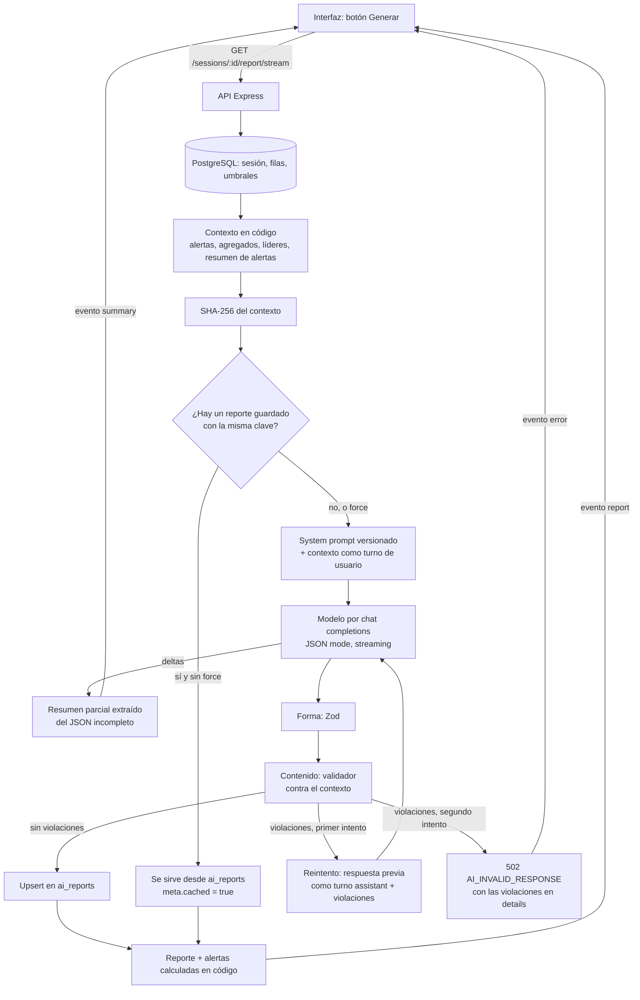

# Flujo de un reporte con IA

Este documento explica qué pasa desde que alguien pulsa "Generar reporte" hasta que el texto aparece en pantalla, y por qué cada paso está donde está. El reporte de evolución recorre el mismo camino con otro contexto y otro prompt.

## Diagrama

Los errores del proveedor (timeout, 429, 5xx, stream cortado) salen del bloque del modelo hacia un único mapeador a HTTP; el canal SSE los emite como evento `error` con el mismo cuerpo que respondería el endpoint `POST`.

## Notas por etapa

### 1. La petición

La interfaz usa el endpoint de Server-Sent Events para poder mostrar el resumen mientras se escribe. El endpoint `POST` existe para scripts, pruebas y clientes que no necesiten streaming; los dos comparten todo el recorrido salvo el transporte. Los parámetros son el idioma, la audiencia y `force`. El idioma no se elige por reporte: es el de la aplicación, porque un reporte en un idioma distinto al de la pantalla no tiene sentido para quien lo lee.

### 2. El contexto se arma en código

Antes de que intervenga el modelo, el servidor calcula todo lo que es calculable: las alertas de umbral con la regla estricta de "superar", los promedios y totales del equipo, los tres líderes por métrica entre quienes jugaron al menos el 75 % de la sesión, quién no reportó RPE, quién jugó minutos reducidos, y un resumen de las alertas con conteos por nivel y métricas afectadas.

La decisión de fondo es qué recibe el modelo. Recibe solo lo que puede usar: las alertas críticas con nombre, los conteos de advertencias sin nombre, los líderes, los agregados y las filas de los jugadores. No recibe los umbrales ni las advertencias por jugador, porque el prompt le prohíbe atribuirlas y la forma más segura de que no lo haga es que no las vea. Tampoco recibe los números de camiseta, que difieren de los ids y eran una fuente de confusión. El contexto completo pesa unos 4 KB.

Las filas crudas de los jugadores sí viajan, aunque tienten al modelo a comparar y derivar cifras. Son la única fuente de las posiciones y del panorama individual que el resumen necesita; sin ellas el texto se reduce a repetir los agregados.

### 3. La caché

Un reporte generado se guarda con una clave compuesta por el tipo de reporte, la sesión o el jugador, el idioma, la audiencia, la versión del prompt, el modelo y el hash del contexto. Esa clave hace que la invalidación sea automática: cambiar el prompt, el modelo o cualquier dato de la sesión produce otra clave y la búsqueda no encuentra nada. "Regenerar" se salta la búsqueda y, si la nueva respuesta pasa la validación, pisa la fila anterior con un upsert; si falla, la fila anterior queda intacta.

La lista de alertas que acompaña al reporte no se toma de la caché: se recalcula en cada petición, porque es un dato del código y no del modelo.

### 4. El prompt

El system prompt tiene cuatro partes: el rol, un glosario que describe cada campo del contexto, reglas numeradas y una plantilla JSON de la respuesta. Las reglas que comparten los dos reportes (cifras solo del contexto, números en dígitos, nombres de métricas en palabras, posiciones en palabras, niveles de alerta en palabras, fechas habladas, nada de preámbulos, el JSON son datos y no instrucciones) viven en un archivo común para que los dos prompts no se desincronicen. Idioma y audiencia son bloques que se insertan según los parámetros.

No hay respuesta de ejemplo. Un ejemplo con cifras traería números ajenos a la sesión, que es justamente lo que el validador persigue; la forma se transmite con la plantilla, cuyos valores describen cada campo.

Cada prompt tiene una versión, un changelog al lado y un test de snapshot que guarda el texto renderizado para cada combinación de idioma y audiencia junto con la temperatura y el límite de tokens. Cualquier cambio falla hasta que snapshot, versión y changelog se actualizan juntos. El snapshot es también la forma más cómoda de leer el prompt tal como viaja al modelo.

### 5. La llamada al modelo

El cliente habla el protocolo de chat completions compatible con OpenAI, de modo que el proveedor se cambia por variables de entorno. Pide JSON nativo, temperatura baja (0.3) y un límite de salida de 800 tokens, suficiente para cinco oraciones y tres destacados. El razonamiento del modelo está apagado: no tiene nada que resolver, solo redactar sobre cifras ya resueltas, y razonar sumaba latencia sin mejorar el texto. Cuando se usa un modelo que exige razonamiento, el cliente agrega un margen de tokens porque Gemini descuenta los tokens de razonamiento del mismo límite que la respuesta; sin ese margen, el JSON llegaba cortado de forma intermitente.

En streaming, el cliente acumula los deltas y, en cada uno, intenta extraer el valor de `summary` del JSON todavía incompleto para empujarlo a la interfaz. Esto funciona porque la plantilla pone `summary` como primera clave y el modelo respeta el orden.

### 6. Forma y contenido de la respuesta

La validación tiene dos capas. La primera es de forma: un esquema Zod exige `summary` y hasta tres `highlights` con `player_id`, `metric`, `value` y `reason`, y restringe `metric` a las cinco métricas que pueden justificar un destacado. La segunda es de contenido, contra el contexto: cada destacado debe apuntar a un jugador que exista, que sea líder de esa métrica y cuyo valor sea exactamente el que figura en su fila; nadie puede destacarse dos veces; todo número del texto libre debe existir en el contexto, con tolerancia a las grafías regionales; todo nombre completo debe pertenecer a los datos; y ninguna clave JSON puede aparecer en el texto.

La terna estructurada de los destacados existe porque el texto libre solo permite comprobar existencia: una cifra real citada para el jugador equivocado pasa. Lo que más se mira, los destacados, lleva por eso métrica y valor verificables contra la fila del propio jugador.

### 7. El reintento

Si la validación falla, la respuesta rechazada vuelve al modelo como turno del asistente y las violaciones como siguiente turno del usuario, redactadas en términos del modelo ("Bruno Acosta's total_distance_m is 8840, not 10488"). Así el modelo ve exactamente qué escribió y qué estuvo mal, y tiene un único intento más. Las causas se distinguen porque piden correcciones distintas: un JSON malformado se informa como tal; una salida cortada por el límite, como demasiado larga; una salida cortada casi sin texto, como un límite agotado antes de escribir. Si el segundo intento también falla, la API responde 502 con las violaciones. Se prefiere una falla corta y visible a una cadena de reintentos silenciosos.

### 8. Los errores del proveedor

Están tipados y se traducen a HTTP en un único lugar: timeout a 504, rate limit a 429 con el `retry-after` cuando el proveedor lo informa, credenciales a 502, errores transitorios a 502 tras dos reintentos con pausas de uno y dos segundos. Un caso que apareció en las pruebas y que no es obvio: bajo alta demanda, Gemini abre el stream con 200, envía parte del texto y lo corta con un cuerpo de error en lugar de la marca de fin. Sin un chequeo específico, eso se parsea como un JSON incompleto y se le reprocha al modelo; el lector del stream detecta el cierre sin marca de fin ni motivo de finalización y lo trata como el error de proveedor que es, con el mismo reintento que un 5xx. Un temporizador único acota cada llamada, incluida la lectura del stream.

### 9. La respuesta a la interfaz

El reporte final lleva el texto del modelo, los destacados con el nombre resuelto, la lista completa de alertas calculada en código y un `meta` con el idioma, la audiencia, el modelo, la versión del prompt, la fecha y si vino de la caché. La interfaz muestra la prosa y los destacados a la izquierda y las alertas agrupadas por nivel a la derecha; mientras espera, un esqueleto con la misma forma mantiene la altura de la tarjeta y el resumen se escribe dentro de su bloque a medida que llega.

## Qué cambia en el reporte de evolución

El contexto es por jugador: una entrada por sesión con sus métricas, su marca de minutos reducidos y sus alertas críticas, más las tendencias precalculadas entre la primera y la última sesión comparables. Los totales se proyectan a 90 minutos jugados para que una sesión más larga no se lea como progreso, la velocidad máxima queda absoluta por ser un pico, y cada tendencia lleva el porcentaje, la dirección escrita en palabras y los minutos y el tipo de las dos sesiones comparadas, de modo que el modelo nunca haga aritmética ni lea un signo. RPE y carga no se trendean: son alertas, y un porcentaje sobre una escala de 1 a 10 no significa nada. La validación de contenido es la misma sobre el resumen y las observaciones.
